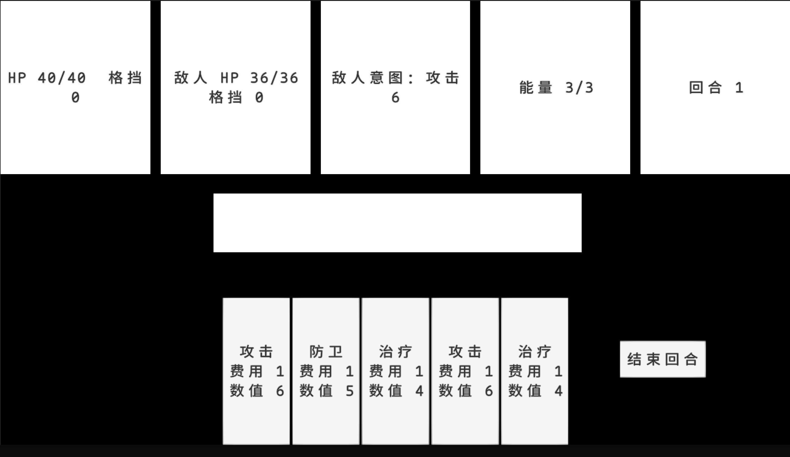

# CardRPGFramework

使用 Unity 与 C# 开发的**简化版《杀戮尖塔》求职 Demo**，重点展示数据驱动、战斗规则与客户端工程化能力，不追求商业级内容量。1.4 之后没有下一个小版本。版本路线见 [`Docs/开发计划/README.md`](Docs/开发计划/README.md)。

**下载。** [Windows 包 `v1.0-demo`](https://github.com/ComeCatchMoonLa/CardRPGFramework/releases/tag/v1.0-demo)（`CardRPGFramework.7z`，Windows 10/11 x64）。解压后运行 `CardRPGFramework.exe`：开始页经地图打完三场，场间经奖励页回地图，第三场经奖励页去结束页。默认窗口 1600×900，可缩放，Alt+Enter 全屏。演示视频 `demo.mp4` 在同一 Release。本地成片在 `Demo/demo.mp4`，该目录不进 git。发布包 tag 是 `v1.0-demo`，文内版本记录到 1.4，两套编号不是一回事。

**运行。** 打开 `Assets/Scenes/TestScene.unity` 点 Play：开始页经地图打完三场，场间经奖励页回地图，第三场经奖励页去结束页。

**测试。** EditMode **320** 项。0.x～1.3 的断言没有改。

**边界。** Effect 做事，Rule 改数字。Buff 不是总线。遗物不是 Buff。局外 `RunState` 和局内 `BattleSession` 是两套状态。Core 程序集不引用 `UnityEngine`。

**架构。**

| 层 | 位置 |
| --- | --- |
| Core | `Assets/Scripts/Runtime/Core/`，`Core.asmdef`（`CardRPGFramework.Core`） |
| Data | `Assets/Scripts/Runtime/Data/` |
| Controllers | `Assets/Scripts/Runtime/Controllers/` |
| Views | `Assets/Scripts/Runtime/Views/` |

## 开发工作流

个人开发阶段采用简单的 trunk-based 工作流，只维护 `main` 分支并保持小步提交；暂不创建 `dev` 分支。

## 运行方式

1. 使用 Unity Hub 安装 `ProjectSettings/ProjectVersion.txt` 中指定的版本（当前为 **Unity 6000.5.9f1**）。
2. 在 Unity Hub 中打开本项目根目录。
3. 打开 `Assets/Scenes/TestScene.unity`。
4. 点击 Play 先到开始页（顶栏 `生命 --/--`、`金币 --`、`牌组 --`、`遗物：无`）。点「开始一局」先到地图（三个点一条线，当前高亮；点「进入」开战），不自动开战：`Assets/Data/Runs/Default.asset` 默认 80 血、10 张起始牌（5 打击 + 4 防御 + 1 痛击）、1 件金刚杵、三场 颚虫 / 蓝奴隶贩子 / 颚虫，奖励池是 9 张可获得卡（不含打击 / 防御）。场间胜利经奖励页再回地图（已完成变灰、当前前进），不自动下一场；第三场胜利仍先经奖励页再去结束页；中途失败不经奖励页，直接结束页（「再来一局」回到开始页，顶栏重新是 `遗物：无`）。奖励页三张互不相同，选一张则顶栏牌组 +1，跳过则张数不变。战斗页 HUD 仍是双方生命与格挡、双方 Buff 层数、能量、三个牌堆数量、遗物行、回合数、敌人意图；手牌费用行带类型，攻击伤害是当前力量 / 易伤修正后的数值。第一场对手是颚虫（`颚虫 HP 42/42  格挡 0`），意图按行动表循环：`攻击 11` → `攻击 7 · 防御` → `增益 · 防御` → `攻击 14`（咆哮给了自己 3 层力量）→ …。开局 Buff 行就有金刚杵给的 `力量 1`、攻击卡卡面 7。痛击给的 `易伤 2` 下一回合变 `易伤 1`、再下一回合消失。第二场蓝奴隶贩子（`攻击 12` → `攻击 7 · 减益`）：耙之后玩家 Buff 行 `虚弱 1`，下一回合攻击卡卡面 5（金刚杵后的 7 × 0.75 向下取整）。在 `Runs/Default.asset` 的 Relics / Deck / Encounters / Reward Pool 里增删即可换配置，不用改代码（蛇颅骨 / 纸鹤 / 剧毒等资产还在，默认短 Run 没配进牌组）。点击手牌使用卡牌，点击「结束回合」推进战斗；不要等结束遮罩。

## 运行测试

1. 打开 Unity 菜单 `Window` → `General` → `Test Runner`。
2. 切换到 **EditMode** 页签。
3. 点击 **Run All**。`CombatantStateTests`、`CardPileTests`、`CardDefinitionTests`、`EffectSpecTests`、`EnemyDefinitionTests`、`BattleSessionTests`（七个 partial 在 `BattleSession/` 子目录：`AnchorCards.cs` 三张锚点卡、`Preview.cs` 预览 = 结算、`Exhaust.cs` 消耗堆、`Relics.cs` 遗物、`Enemies.cs` 敌人行动表、`RoundEnd.cs` 轮末减层）、`RunStateTests`（`Run/` 子目录）、`ActionQueueTests`、`EffectTests`、`BuffTests`、`BuffFactoryTests`、`RelicFactoryTests`、`DamageRuleTests`、`EffectSpecDataTests`、`EnemyActionDataTests`、`CardDescriptionFormatterTests` 与 `IntentFormatterTests` 应全部通过（共 320 项：0.1～0.7 的 263 项不改断言；1.0 新增残血开战 11 项、`RunStateTests` 28 项；1.1 断言未改；1.2 的 `RunStateTests` 加 4 项 NodeType；1.3 的 `RunStateTests` 加 11 项奖励抽取、`CardDescriptionFormatterTests` 加 3 条类型中文。0.1～0.5 的 203 项中 202 项未改断言——0.1 的 79 项在 0.2 只改过卡牌构造方式，0.6 把它们的敌人参数改为经 `FixedAttacker` 构造的 `EnemyDefinition`；唯一改断言的 1 项是中毒用例的敌人格挡 10 → 0，因为 0.6 起敌人回合开始先清敌人格挡；0.6 新增 43 项；0.7 新增 17 项。0.x～1.2 断言未改）。

## 目录说明

- `Assets/Scripts/Runtime/`：C# 代码。`Core/Core.asmdef`（`CardRPGFramework.Core`，`noEngineReferences: true`）只包住 `Core/`。`Runtime.asmdef` 引用 `Unity.TextMeshPro`、`UnityEngine.UI` 与 `CardRPGFramework.Core`。按依赖方向分四层：
  - `Core/`：纯 C# 战斗规则（`Battle`/`Combatants`/`Cards`/`Actions`/`Effects`/`Buffs`/`Rules`/`Relics`/`Enemies`/`Run`），不引用 `UnityEngine`。`Actions` 只知道"排队和执行"，`Effects` 只知道"怎么改 `CombatantState`"，两者互不知道调用方是谁（详见 [Phase 2a 技术设计](Docs/开发计划/Ver%200.x/0.1/Phase%202a/技术设计.md)）；`Buffs` 保存 Buff 核心状态，只有需要生命周期行为的 Buff 才额外实现 `IBuffTrigger`，触发逻辑下沉到具体子类自己实现（详见 [Phase 2b 技术设计](Docs/开发计划/Ver%200.x/0.1/Phase%202b/技术设计.md)）；回合型 Buff（虚弱 / 易伤）继承 `DurationBuff` 并由它实现 `IRoundEndTrigger`，轮末减层与刚施加保护都在这一层、`BuffState` 不加字段，`Battle` 的三个固定时机（开战遗物 / 回合开始 Buff / 轮结束）各是一个独立遍历、不合并成事件（详见 [0.7 技术设计](Docs/开发计划/Ver%200.x/0.7/技术设计.md)）；`Rules` 是纯函数（只读 Buff、只写伤害数值），固定两段管线写死在 `DamageCalculator` 内部，不做注册引擎（详见 [Phase 2c 技术设计](Docs/开发计划/Ver%200.x/0.1/Phase%202c/技术设计.md)）；`Cards` 里的 `EffectSpec` 是封闭的五种效果原语，只描述"做什么、对谁、多少"、不带执行逻辑，把它变成 Action 的地方只有 `BattleSession.ToAction`，`Cards` 不引用 `Actions` / `Buffs`（Buff 只是字符串 Id，由 `Buffs/BuffFactory` 解析）（详见 [0.2 技术设计](Docs/开发计划/Ver%200.x/0.2/技术设计.md)）；`Battle` 另暴露两个只读预览，复用 `Rules` 的 `DamageCalculator`，是界面上公式后数字的唯一来源（详见 [0.3 技术设计](Docs/开发计划/Ver%200.x/0.3/技术设计.md)）；打出后的去向由 `Cards` 里的 `CardDefinition.ExhaustsWhenPlayed`（类型默认 + 消耗关键词）回答，`CardPile` 是四个牌区的哑容器、消耗堆只进不出，`Battle` 只问结果、不认类型（详见 [0.4 技术设计](Docs/开发计划/Ver%200.x/0.4/技术设计.md)）；`Buffs/BuffIds` 是 Buff Id 字面量的唯一出处；`Relics` 是遗物基础设施与三件标本——遗物不是 Buff，挂在 `CombatantState` 独立列表里，钩子形状与 `IBuffTrigger` 相同（开战钩子只入队 Action、施加钩子直接改这一次的 `BuffState`），改公式常数的遗物不设钩子、由对应 Rule 读"是否持有"，`Battle` 只认 `RelicState` 与 `IBattleStartRelic`（详见 [0.5 技术设计](Docs/开发计划/Ver%200.x/0.5/技术设计.md)）；`Enemies` 是敌人定义与行动表——`EnemyAction` = 效果列表、`EnemyDefinition` = 血量 + 至少一条行动，只引用 `Cards`、和 `Cards` 一样只描述不执行；`Battle` 按行动表固定循环执行敌人回合，`ToAction` 是卡牌与敌人行动共用的唯一 `EffectSpec → IAction` 转换点，`Session` 里没有任何敌人 Id 或按敌人的分支（详见 [0.6 技术设计](Docs/开发计划/Ver%200.x/0.6/技术设计.md)）；`Run` 是局外状态——`RunState` 输出 `BattleInput`、接收 `ApplyResult`、提供 `AddCard` 与 `CreateRewardChoices`，节点带 `NodeType`（本版只有 `Combat`），不创建 `BattleSession`（详见 [1.0 技术设计](Docs/开发计划/Ver%201.x/1.0/技术设计.md) / [1.3 技术设计](Docs/开发计划/Ver%201.x/1.3/技术设计.md)）；产品侧 `Begin` 只在进入当前战斗节点，胜利后先奖励页（详见 [1.2 技术设计](Docs/开发计划/Ver%201.x/1.2/技术设计.md) / [1.3 技术设计](Docs/开发计划/Ver%201.x/1.3/技术设计.md)）。
  - `Data/`：`CardData`（含 `exhaust` 勾选）/`EffectSpecData`/`RelicData`/`EnemyData`/`EnemyActionData`/`RunConfig`（含 `encounters` 三场敌人、`relics` 列表与 `rewardPool`）等 ScriptableObject 配置定义，`Data → Core` 单向依赖，`ToDefinition` 把可序列化的效果条目转成 `EffectSpec`（卡牌与敌人行动共用 `EffectSpecData`），`CreateRunState` 把一局开战配置落成 `RunState`。必填字段不给能通过校验的默认值，漏填在启动校验就报出来。`BattleConfig` 已删除。
  - `Controllers/`：`RunController` 持有唯一一份 `RunConfig` 与 `RunState`，是局内命令与开局 / 进节点 / 再来一局的入口；`BattleController` 只负责 `Begin` / `DiscardSession` / 转发命令与只读状态、把遗物 Id 翻成显示名（`RelicDisplayName` / `SetRelicDisplayNames`）。
  - `Views/`：`RunShellView`/`StartPageView`/`MapPageView`/`BattleView`/`RewardPageView`/`ResultPageView`/`CardButtonView` 与纯函数 `CardDescriptionFormatter`/`IntentFormatter`/`BuffDisplayNames`/`CardTypeDisplayNames`，纯显示与输入捕获，不直接调用 `Core`/`Data`，不复算任何伤害公式（描述生成器只读 `CardDefinition` 与一个 `int → int` 预览委托；奖励页用无委托版本；意图生成器只读 `EnemyAction` 与 Controller 转发的预览总和）；卡面类型中文在 `CardTypeDisplayNames`，消耗关键词行由 `CardDescriptionFormatter` 追加；遗物行的显示名问 Controller，不设 `RelicDisplayNames`。`EndScreenView` 已删除。
- `Assets/Scripts/Tests/EditMode/`：`Core`、`Data` 校验与纯函数 View（卡面文案、意图文案）的 EditMode 单元测试（`Tests.asmdef` 同时引用 `Runtime` 与 `CardRPGFramework.Core`；`BattleSessionTests` 的七个 partial 在 `BattleSession/` 子目录；`RunStateTests` 在 `Run/` 子目录；根目录到 15 个测试文件，0.7 起新文件进子目录）。Controllers/带 MonoBehaviour 的 Views 是薄封装/展示层，按技术设计文档的测试策略不做单元测试，靠 Play 模式手动验收。
- `Assets/Data/Cards/`、`Assets/Data/Relics/`、`Assets/Data/Enemies/`、`Assets/Data/Runs/`：运行时 ScriptableObject 配置资产（攻击/防御/治疗/力量强化（能力）/剧毒/虚弱/易伤/痛击/双击/剑柄打击/坚不可摧（消耗）共 11 种卡牌；金刚杵/蛇颅骨/纸鹤三件遗物；颚虫 / 固定攻击敌人 / 蓝奴隶贩子三份 `EnemyData`；`Runs/Default`：80 血、10 张起始牌、1 件金刚杵、三场 颚虫 / 蓝奴隶贩子 / 颚虫、奖励池 9 张可获得卡）。
- `Assets/Scenes/`：Unity 场景，`TestScene` 是 Run 壳（Start / Map / Combat / Reward / Result + 常驻顶栏；`RunController` + `BattleController`）。
- `Docs/`：设计文档。`开发计划/` 按版本存放各版本的游戏设计 / 技术设计 / TODO（`Ver 0.x/0.1/` 是已完成的 Phase 1 / 2 与历史 MVP 计划）；`详细游戏设计文档参考/` 是杀戮尖塔局内规则对照表；根目录是跨版本的机制研究、扩展边界批注与启动期设计思路。
- `Packages/`：Unity Package Manager 依赖清单。
- `ProjectSettings/`：Unity 工程设置。

## 已知限制

- **中文字体**：界面用动态字体 Maple Mono NF CN Regular（`Assets/TextMesh Pro/Fonts/MAPLEMONO-NF-CN-REGULAR SDF.asset`，源文件是同目录的 `MAPLEMONO-NF-CN-REGULAR.TTF`）。图集 8192×8192，Multi Atlas 开着，采样点大小 96、Padding 10。`Clear Dynamic Data On Build` 开着，播放器里的字在运行时从这份 TTF 光栅。
- **打出时序（0.1 的"`EnqueueCardAction` 结算顺序"一条，0.2 已解决）**：`BattleSession.TryPlayCard` 现在是"扣能量 → `TakeFromHand`（离手，此刻不在任何牌区）→ 按效果列表 `ToAction` 入队并 `RunAll` → 按 `ExhaustsWhenPlayed` `AddToDiscard` 或 `AddToExhaust`"。抽牌类效果结算时打出的牌已经离手，抽到的牌落在手牌末尾；抽牌堆为空触发重洗时它不在弃牌堆里，不会被洗回去。`EnqueueCardAction` 与 `CardPile.PlayCard` 已删除，见 [0.2 技术设计](Docs/开发计划/Ver%200.x/0.2/技术设计.md) 第 4.4 / 4.6 节。仍留的口子："离手到落堆"之间牌不在任何牌区，原版此时可以被"复制打出"类效果读到，那需要给 `CardPile` 加显式的"结算中"位置，出现消费者再做。
- **"消耗"只在打出时生效**：`CardPile.DiscardHand` 与重洗都不看关键词——留在手里的坚不可摧回合结束进弃牌堆、下回合还能抽到，这是原版规则（在这里看关键词是"虚无"的语义，0.4 没有虚无）；被效果消耗（"消耗手牌中一张牌"）是另一个时机，尚无消费者。`CardType.Power = 2` 追加后，`CardData` 的越界校验拦不住 0.1 旧资产残留的整数 2（它现在是合法的能力牌），手改资产时只能靠 Inspector 核对类型。
- **遗物钩子只有两种时机、且只入队 Action**：`IBattleStartRelic.OnBattleStart(owner, queue)` 不带对手参数（弹珠袋来了再加），钩子里只入队 Action、不直接改状态；`IApplyBuffModifier` 只能改这一次施加的 `BuffState`，不能取消施加（人工制品来了再加）；遗物没有回合开始 / 结束钩子，`LoseHp` 前也没有挂钩（钨条）。三件遗物都在玩家身上，敌人遗物没有消费者。遗物栏由 Run 提供（`RunConfig.relics` → `SetRelicDisplayNames`；默认短 Run 只配金刚杵）。`WeakDamageRule` 是 Core 里唯一按具体遗物 Id 分支的地方——改公式常数的遗物就该改对应 Rule 一处，Session 不认遗物 Id。
- **预览是格挡前的最终伤害**：卡面与意图上的数字是 `DamageCalculator` 的输出，不扣格挡——玩家先打防御再看意图，意图仍显示公式后数值，实际掉血更少或不掉。这与原版意图一致，是设计不是缺陷；把格挡折进预览就得在 Session 或 View 复算 `TakeDamage`，等于第二条结算路径。预览读的是此刻的 Buff，痛击自己即将施加的易伤不算进它的 8 点，与结算的"先伤后易伤"一致；多段攻击的意图数字是各段独立取整后的和。
- **`EnemyTurn` 仍是瞬时阶段，行动表是固定循环**：敌人回合（清敌人格挡 → 中毒 → 当前行动 → 推进指针 → 轮结束）在 `TryEndPlayerTurn` 里一次跑完，没有 AI 决策、动画等待或分段，外部几乎观察不到 `EnemyTurn`。行动顺序固定循环（原版颚虫按概率选招且同一招不连用），出现概率或"不能连用"时再抽行动模式对象——现在的行动指针只是一个 `int`。配置校验仍拒绝空行动（没有沉睡类敌人之前防漏配）；"敌人给玩家上 Buff"已随 0.7 放开。意图只有文字、由效果推导，没有图标，Core 里没有意图枚举。
- **回合型 Buff 只有虚弱 / 易伤两种，时机只有"轮结束"一个**：减层在 `TryEndPlayerTurn` 的未失败分支里双方一起做一次，没有 `OnTurnEnd`（角色行动结束）时机、没有负层（缴械）、没有取消施加（人工制品），也没有"叠加刷新保护"——叠加走 `AddStacks`、带保护的新实例被丢弃，连续两次耙恰好两个玩家回合。玩家回合开始自减到 0 的中毒要到本轮末才出字典，中间仍靠 `BattleView` 的 0 层过滤；敌人侧的减 0 与移除在同一次 `TryEndPlayerTurn` 里完成，界面观察不到 0 层。
- **`BattleSession` 身兼多职**：战斗生命周期、回合、能量、卡牌流转、敌人行动表的执行与指针都在一个类里；效果结算已迁移到独立的 `Core/Actions`/`Core/Effects`（Phase 2a），`EffectSpec → IAction` 的转换（`ToAction`）有意留在 Session 私有方法里——它依赖的全是 Session 字段，0.6 敌人行动成了它的第二个调用方但仍在 Session 内（`source` 传 `Enemy`），预期中"Session 以外的调用方"没有出现，所以没有抽成工厂。其余职责暂不拆分。
- **Controllers/Views 无自动化测试**：`BattleController`/`BattleView` 等只做转发和展示，真正的规则逻辑都在已被覆盖的 `BattleSession`；为它们搭 PlayMode 测试基建的收益暂不成比例，可靠性依赖手动 Play 模式验收。
